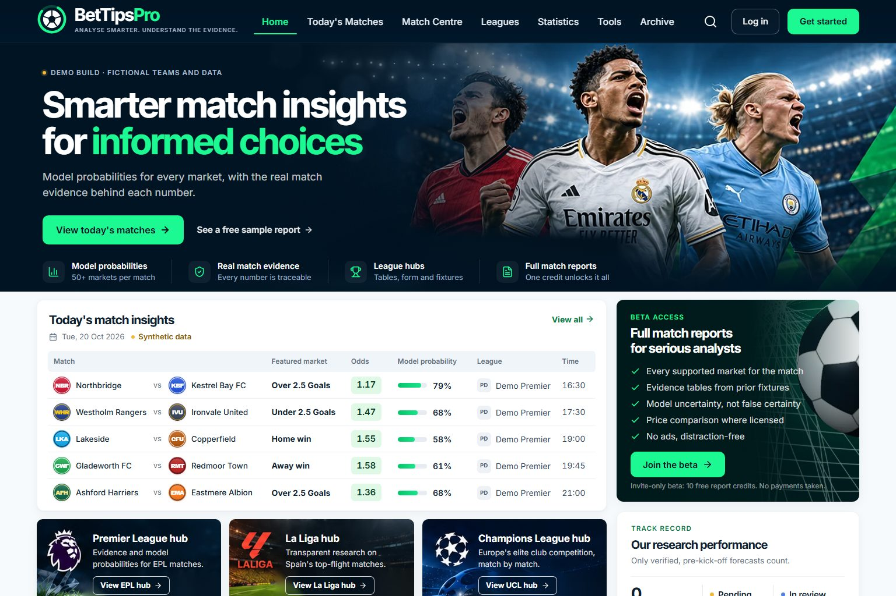
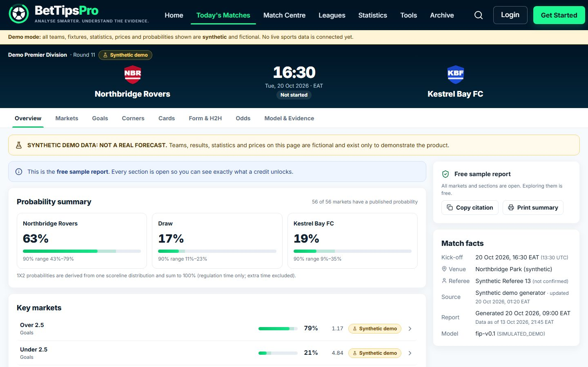
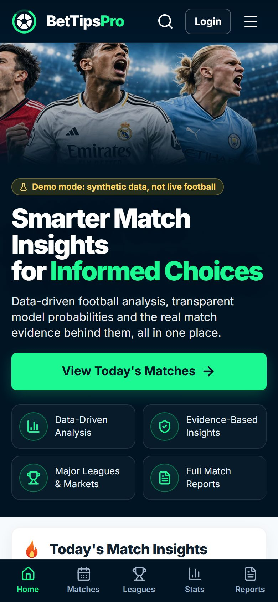
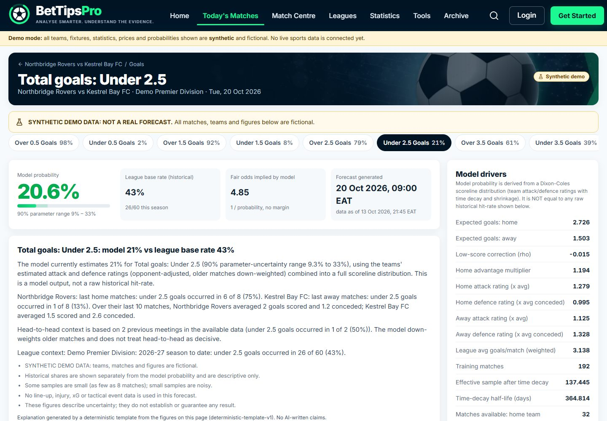
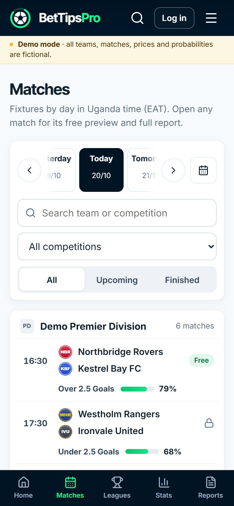
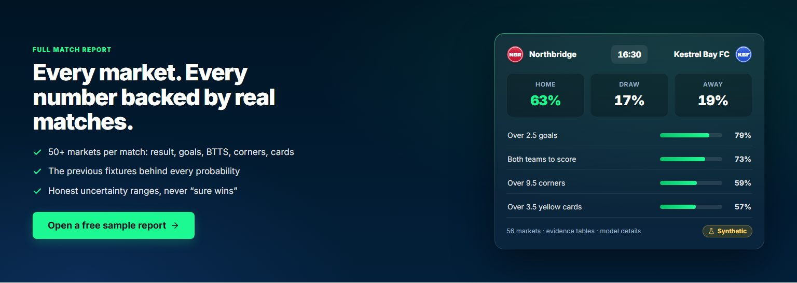

<div align="center">

# BetTipsPro: Football Match Intelligence

**Model probabilities, the real match evidence behind them, and honest uncertainty, for every fixture.**

Built by **Motion Imprints Technologies** · Private beta · `BetTipsPro` is a placeholder brand name, not final



</div>

> [!NOTE]
> The beta runs in **demo mode** by default. Every club, fixture, statistic, price and probability you see is **synthetic and fictional**, and is clearly labelled as such throughout the app. Real data appears only after an API-Football key is connected.

---

## What it does

Open any fixture and get a full research report: probabilities for 50+ markets, each one backed by the actual prior matches that drive it.

| | |
|---|---|
| **Match insights** | Daily fixture board with one featured market per match, its model probability and (when licensed) the bookmaker price. |
| **Full match reports** | 1X2, double chance, goal lines, BTTS, team goals, correct score, first half, corners and yellow cards, each with a 90% uncertainty range and a data-quality label. |
| **Evidence pages** | For any market: home and away samples, last-10 form, head-to-head, league base rate, referee history (for cards), score and count distributions, model drivers, prices, settlement rules and source fixture IDs. |
| **Honest track record** | Every forecast is stored immutably with its data cut-off and settled after the match. No win-rate or ROI marketing. |
| **Credits, not bets** | Invite-only beta: 5 testers × 10 report credits. One credit unlocks a whole match. Reopening it or exploring more markets is free. No payments, no betting. |
| **Admin console** | Testers and invites, credit ledger, fixtures, API budget and ingestion jobs, forecast runs and coverage, feedback triage, audit log. |

<table>
<tr>
<td width="62%"></td>
<td width="38%"></td>
</tr>
<tr>
<td></td>
<td></td>
</tr>
</table>



## Quick start

**Requirements:** Node.js ≥ 20.19 (tested on 24), Git. Python 3.12 with `numpy pandas scipy statsmodels pytest` is only needed to retrain the models.

```bash
git clone https://github.com/Isaac25-lgtm/BETIPSPRO.COM.git
cd BETIPSPRO.COM
npm install
npm run setup:local      # creates .dev.vars with random secrets, migrates + seeds the local database
npm run dev              # http://localhost:5173
```

Then, in a second terminal while the dev server is running:

```bash
npm run setup:local      # creates the admin account and prints the password once
npm run beta:bootstrap -- --admin-email admin@localhost.test --admin-password <printed> --invite tester1@example.com,tester2@example.com
```

Testers open `/join`, enter their invite code, the invited email and a password, confirm they are 18+, and receive 10 report credits. A free sample report is always open without signing in.

> Demo fixtures are re-anchored to "today" (Uganda time) when the database is seeded. On a later day, run `npm run db:reset` to refresh them.

## Local reference preview (owner's machine only)

The owner's reference design uses photos of real players and official league emblems. These **cannot ship publicly** without licences, so the repository contains original artwork only. To preview the site exactly like the reference on your own machine:

```bash
# needs design/reference/homepage-reference.png (kept out of Git)
python design/scripts/render_local_hero.py     # hero with the reference players
python design/scripts/render_local_tiles.py    # league tiles with official emblems (text removed)
echo VITE_LOCAL_REFERENCE_HERO=true > .env.local
npm run dev
```

Safeguards: the images go to `public/images/local/` (gitignored), the flag only works in `npm run dev`, and every production build deletes `images/local` automatically. The README screenshots above were taken in this preview mode at the owner's request. Before any public launch, make the repository private and replace these images with licensed photos and logos.

## How it works

```
React SPA ──/api/v1──▶ Cloudflare Worker (Hono) ──▶ Cloudflare D1 (SQLite)
                         │  auth · credits · reports · evidence · admin
                         └─▶ API-Football (free plan) via ONE metered budget gateway
Python model pipeline (offline) ──artifact JSON──▶ authenticated admin import
```

- **Frontend:** React 19, React Router 7, Vite 7, hand-built CSS design system (tokens measured from the reference design), lucide icons, no chart library.
- **API:** Hono 4 + Zod on Cloudflare Workers; static assets and API ship as one Worker.
- **Database:** Cloudflare D1 with migrations, append-only credit ledger, immutable forecasts and audit log.
- **Models (offline, Python):** Dixon-Coles goals model with time decay; separate first-half model; negative-binomial corners and yellow-cards models with team and referee effects; Laplace-approximation uncertainty; rolling-origin backtests vs base rates.
- **Data:** API-Football free plan behind an atomic daily budget (80 + 20 reserve, hard cap 100) and a 10/minute limit. Report views never call the provider.
- **AI (optional, off):** Gemini via Vertex for cached summaries. Every number is reconciled against the evidence; certainty language is rejected; spend is capped.

More detail: [technical architecture](docs/technical-architecture.md) · [database schema](docs/database-schema.md) · [market taxonomy](docs/market-taxonomy.md) · [model validation](docs/model-validation.md)

## Commands

| Command | Purpose |
|---|---|
| `npm run dev` | SPA + Worker + local D1 with hot reload |
| `npm run build` · `npm run preview` | Production build; serve the built Worker locally on :8787 |
| `npm run db:reset` | Recreate the local database with fresh synthetic data |
| `npm test` | Unit, integration and security tests against a real local D1 |
| `npm run test:e2e` | Playwright walkthrough + visual checks at 10 screen sizes |
| `npm run test:load` | Local load matrix (1 / 5 / 25 / 100 / 500 users) after `npm run build` |
| `npm run model:test` · `npm run model:demo` | Model invariant tests · regenerate the synthetic artifact |
| `node scripts/import-artifact.mjs` | Import a real-data model run through the admin API |
| `node scripts/readme-screenshots.mjs` | Regenerate the README screenshots (run with the local preview flag off) |

## Project structure

```
src/              React app (pages, components, styles)
worker/           Cloudflare Worker API (routes, middleware, services, providers)
shared/           Brand config + market catalogue shared by TypeScript and Python
migrations/       D1 SQL migrations
model-pipeline/   Python statistical models, backtests and artifact export
fixtures/demo/    Synthetic demo artifact (fictional data)
tests/            unit · integration · security · e2e · performance
design/           Brand directions, artwork renderer, visual QA checklist
docs/             Decisions, status, runbooks, compliance and setup guides
```

## Quality status

| Check | Result |
|---|---|
| TypeScript | clean |
| Unit + integration + security (real local D1) | 45 / 45 passing |
| Python model tests | 19 / 19 passing |
| Credit concurrency | no double-charges under parallel unlocks or a 500-user storm |
| Provider budget | hard caps enforced atomically; cached report views make 0 upstream calls |
| Load (one local process) | 0% errors up to 100 concurrent users; 500 users **not yet demonstrated** |
| Layout | No horizontal overflow at 320 – 1536 px; touch targets ≥ 44 px |

Full status, known limitations and the acceptance checklist are in [docs/status.md](docs/status.md).

## Connecting real data

Two free providers are supported and metered through the same budget gateway:

- **football-data.org**: current-season fixtures and results for 12 major competitions (`FOOTBALL_DATA_ORG_KEY`). Used for live testing.
- **API-Football**: historical seasons 2022-2024 on the free plan, with corners and cards (`API_FOOTBALL_KEY`). Used for research.

Loading data (admin): `node scripts/provider-probe.mjs --admin-email … --admin-password … --jobs '[{"kind":"fdo_competition","competition":"PL"}]'`, then export, fit and import (`docs/setup-free-api-football.md`).


1. Create **one** free account at [dashboard.api-football.com](https://dashboard.api-football.com/register).
2. Put the key in `.dev.vars` (gitignored), never in code, chat or commits:
   ```dotenv
   API_FOOTBALL_KEY=your-key
   SPORTS_PROVIDER=api_football
   ```
3. Admin → *Ingestion & API budget* → run the connection test, then load a pilot league.

Step-by-step guide: [docs/setup-free-api-football.md](docs/setup-free-api-football.md).

## Responsible use & compliance

This is an **information and research** product for adults (18+). It does not take bets, hold money or tell anyone what to bet; probabilities are uncertain and never guarantee a result. The shipped application uses no club crests, league emblems or player photos; all artwork in production builds is original. (README screenshots show the owner's local reference preview.)

Before any public or paid launch, these gates remain open: brand/trademark, data-publishing rights, Ugandan regulatory classification, reviewed legal pages, and a licensed payment provider. See [release checklist](docs/release-checklist.md) and [licensing & compliance](docs/licensing-and-compliance.md).

## Deployment

Nothing is deployed. The project is ready for Cloudflare Workers + D1; follow the [deploy runbook](docs/cloudflare-deploy-runbook.md). Each step needs owner approval. CI runs on every push ([ci.yml](.github/workflows/ci.yml)); preview deploys are disabled unless explicitly approved.

## License

Proprietary. © 2026 Motion Imprints Technologies. All rights reserved.
